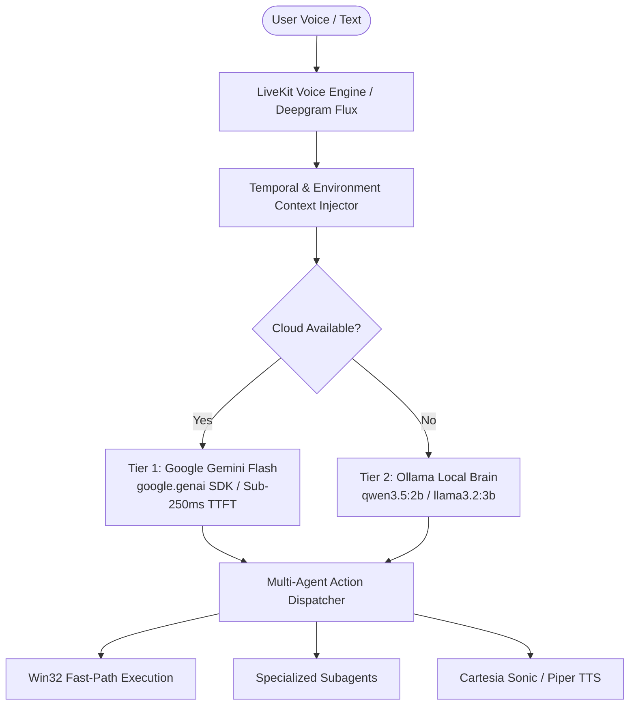
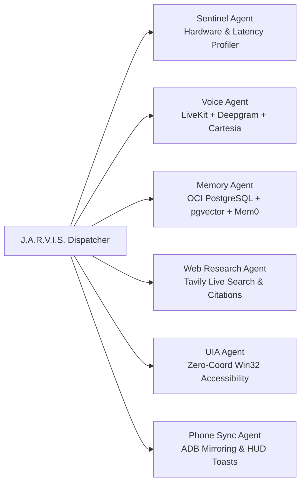

# J.A.R.V.I.S. Agent Architecture & Multi-Agent Roadmap

This document outlines the cognitive architecture of J.A.R.V.I.S., the rules governing its dual brain (Gemini Flash Primary + Ollama Local Fallback), and the multi-agent orchestration roadmap.

---

## 🧠 Cognitive Dual Brain (Primary Orchestrator)

J.A.R.V.I.S. utilizes a **Two-Tier Cognitive Architecture** to ensure zero latency, deep reasoning, and 100% offline uptime:

### 1. Primary Cloud Brain: Google Gemini Flash
* **SDK:** Modern official `google.genai` SDK.
* **Role:** High-speed multi-turn reasoning, Socratic debate logic, live tool calling, and document synthesis.
* **Latency:** ~150–250ms Time-To-First-Token (TTFT) with 100+ tokens/second throughput.

### 2. Local Fallback Brain: Ollama (Qwen / Llama)
* **Endpoint:** `http://127.0.0.1:11434`.
* **Role:** Instant local failover if internet connectivity is interrupted. Runs completely offline with zero API dependencies.

---

## 🤖 Multi-Agent Orchestration Roster

### Agent 1: LiveKit Voice Agent Worker
* **Location:** [`voice/livekit_worker.py`](file:///C:/Users/Chowdary/Desktop/Project/Jarvis/voice/livekit_worker.py)
* **Responsibility:** Real-time WebRTC audio pipeline, streaming STT, and streaming TTS.
* **Unified Turn Authority:** Uses **Deepgram Flux** conversational endpointing as the single master turn detector to prevent VAD conflicts.
* **Instant Barge-In:** Cancels audio playback the millisecond user speech is detected.

### Agent 2: Speculative Preemptive Generation Agent
* **Responsibility:** Begins speculative draft generation during conversational pauses before the user's turn is 100% closed.
* **Conflict Resolution:** If the user resumes speaking, the speculative draft is discarded with zero disruption to the dialogue.

### Agent 3: Memory Persistence & Synchronization Agent
* **Location:** [`memory/sync_queue.py`](file:///C:/Users/Chowdary/Desktop/Project/Jarvis/memory/sync_queue.py)
* **Responsibility:** Manages state persistence across sessions.
* **Resilience Pattern:** Targets **OCI PostgreSQL + `pgvector`** (Hyderabad). If offline, writes to local write-ahead log (`data/cache/offline_sync_queue.jsonl`) and auto-syncs upon reconnection.

### Agent 4: Web Research Agent
* **Location:** [`tools/web_search.py`](file:///C:/Users/Chowdary/Desktop/Project/Jarvis/tools/web_search.py)
* **Responsibility:** Executes real-time web searches via Tavily, returning verified facts and source URLs.

### Agent 5: UIA & Desktop Automation Agent
* **Responsibility:** Inspects foreground windows via Win32 `EnumChildWindows`, computing bounding rectangles to target controls by name without pixel coordinates.

### Agent 6: Sentinel Hardware & Telemetry Agent
* **Responsibility:** Polls CPU, RAM, GPU, and network I/O, as well as tracking live Time-to-First-Audio (TTFA) telemetry.
