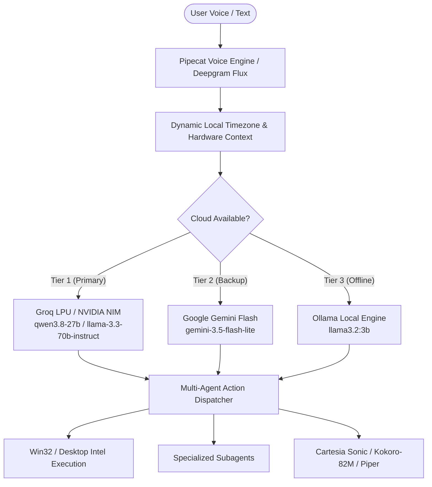
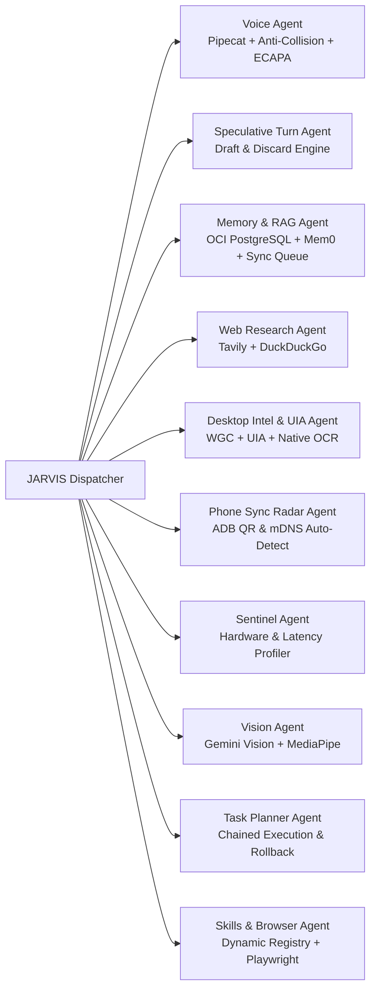

# JARVIS Agent Architecture & Multi-Agent Roadmap

This document outlines the cognitive architecture of JARVIS, the rules governing its multi-tier brain (Groq LPU / NVIDIA NIM Primary + Google Gemini Flash Cloud Backup + Ollama Local Fallback), and the multi-agent orchestration roster. All runtime state—including timezone, geolocation, weather, phone discovery, and contacts—is resolved dynamically with zero static or hardcoded data.

---

## ⚡ 1. Finalized Component Matrix

| Component | Primary (Online) | Fallback (Offline / Failover) | Technical Role |
| :--- | :--- | :--- | :--- |
| **Real-Time Voice Pipeline** | **Pipecat Voice Agent** (`voice/pipecat_voice_agent.py`) | Local Audio Loop | Manages full-duplex audio streams, VAD, and bidirectional interruption handling. |
| **Audio Enhancement** | **WebRTC AEC3 (`pyaec`) + RNNoise** (`voice/audio_enhancer.py`) | Direct PCM Pass-Through | Acoustic echo cancellation and noise suppression on 16 kHz mono PCM. |
| **Speaker Verification** | **ECAPA-TDNN** (`voice/ecapa_verifier.py`) | Open Access (Unenrolled) | 192-d SpeechBrain speaker embeddings with anti-spoofing liveness checks. |
| **Speech-to-Text (STT)** | **Deepgram Flux** | **Faster-Whisper / Web Speech** (Local) | Real-time streaming transcription with conversational boundary awareness. |
| **Text-to-Speech (TTS)** | **Cartesia Sonic** | **Kokoro-82M ONNX + Piper TTS** | Primary: ~90ms conversational audio. Fallback: studio-quality local neural synthesis. |
| **Core LLM** | **Groq LPU** (`qwen/qwen3.8-27b`) / **NVIDIA NIM** (`llama-3.3-70b-instruct`) | **Gemini Flash** → **Ollama** (`llama3.2:3b`) | Multi-tier reasoning, Socratic debate, and local offline execution. |
| **Database & Vectors** | **PostgreSQL + pgvector** *(OCI Hyderabad)* | Local Buffer + Dead-Letter Sync Queue | Enterprise hybrid search (Full-Text + Vector), relational memory, and citations. |
| **Long-Term Memory** | **Mem0** *(PostgreSQL Backend)* | Local JSONL Write-Ahead Log | Extracts facts, preferences, and user profile data across sessions with sync. |
| **RAG & Citations** | **LlamaIndex** *(Hybrid Engine)* | Local Document Cache | Vector similarity + SQL full-text search with strict page/document citations. |
| **Live Web Research** | **Tavily Search API** (`tools/web_search.py`) | DuckDuckGo | Real-time news and factual validation with cited URLs and TTL caching. |
| **Browser Automation** | **Playwright Controller** (`tools/playwright_browser.py`) | Default System Browser | Persistent Chromium automation via local HTTP control on port `5006`. |
| **Telemetry & Metrics** | **Custom Pipeline Profiler** (`core/telemetry.py`) | Built-in | Tracks live Time-To-First-Audio (TTFA) and probes local service health. |
| **Security & Secrets** | **Windows DPAPI Vault** (`crypt32.dll`) | `.env.local` / `.env` | Hardware-bound credential encryption at rest without plaintext secrets. |

---

## 🧠 2. Cognitive Multi-Tier Brain Hierarchy

JARVIS utilizes a **Multi-Tier Cognitive Architecture** (`core/llm_client.py`) with circuit breakers, prompt-injection sanitization, secret redaction, and sliding-window context compression:

### 1. Tier 1 (Primary Online): Groq LPU & Optional NVIDIA NIM
* **Groq LPU:** `qwen/qwen3.8-27b` for ultra-low-latency streaming and tool dispatch.
* **NVIDIA NIM (Optional):** `https://integrate.api.nvidia.com/v1` (`meta/llama-3.3-70b-instruct`) when `NVIDIA_API_KEY` is configured.

### 2. Tier 2 (Cloud Backup): Google Gemini Flash
* **SDK:** Official `google.genai` SDK (`gemini-3.5-flash-lite` / `gemini-2.5-flash` vision).
* **Role:** High-speed cloud failover when primary providers hit rate limits or circuit-breaker cooldowns.

### 3. Tier 3 (Offline Fallback): Ollama
* **Endpoint:** `http://127.0.0.1:11434` (`llama3.2:3b`).
* **Role:** Instant local failover for 100% offline operation.

---

## 🤖 3. Multi-Agent Orchestration Roster

### Agent 1: Pipecat Voice Agent, Anti-Collision Arbiter & Speaker Verification
* **Locations:** [`voice/pipecat_voice_agent.py`](file:///C:/Users/Chowdary/Desktop/Project/Jarvis/voice/pipecat_voice_agent.py), [`voice/audio_device_binding.py`](file:///C:/Users/Chowdary/Desktop/Project/Jarvis/voice/audio_device_binding.py), [`voice/audio_enhancer.py`](file:///C:/Users/Chowdary/Desktop/Project/Jarvis/voice/audio_enhancer.py), [`voice/ecapa_verifier.py`](file:///C:/Users/Chowdary/Desktop/Project/Jarvis/voice/ecapa_verifier.py), [`scripts/neural_tts_service.py`](file:///C:/Users/Chowdary/Desktop/Project/Jarvis/scripts/neural_tts_service.py), [`src/main.js`](file:///C:/Users/Chowdary/Desktop/Project/Jarvis/src/main.js)
* **Responsibility:** Full-duplex audio pipeline, WebRTC AEC3 (`pyaec`) echo cancellation, ECAPA-TDNN speaker verification, streaming Kokoro-82M / Piper TTS, system audio ducking (`set_system_ducking`), Promise-locked `processDirective`, and `stopAllSpokenAudio()` instant barge-in.

### Agent 2: Speculative Preemptive Generation Agent
* **Locations:** [`core/speculative.py`](file:///C:/Users/Chowdary/Desktop/Project/Jarvis/core/speculative.py), [`src-tauri/src/lib.rs`](file:///C:/Users/Chowdary/Desktop/Project/Jarvis/src-tauri/src/lib.rs)
* **Responsibility:** Observes interim speech tokens and begins speculative draft generation during conversational pauses (>350ms), discarding on intent change or promoting matching prefixes to shave 200–450ms from TTFA.

### Agent 3: Memory Persistence & RAG Agent
* **Locations:** [`memory/db_postgres.py`](file:///C:/Users/Chowdary/Desktop/Project/Jarvis/memory/db_postgres.py), [`memory/mem0_store.py`](file:///C:/Users/Chowdary/Desktop/Project/Jarvis/memory/mem0_store.py), [`memory/rag_engine.py`](file:///C:/Users/Chowdary/Desktop/Project/Jarvis/memory/rag_engine.py), [`memory/sync_queue.py`](file:///C:/Users/Chowdary/Desktop/Project/Jarvis/memory/sync_queue.py), [`src-tauri/src/lib.rs`](file:///C:/Users/Chowdary/Desktop/Project/Jarvis/src-tauri/src/lib.rs)
* **Responsibility:** Manages Mem0 user profile extraction, LlamaIndex hybrid RAG citations, and OCI PostgreSQL synchronization with local write-ahead buffering and dead-letter queue resilience via `sync_memory_cloud`.

### Agent 4: Web Research Agent
* **Locations:** [`tools/web_search.py`](file:///C:/Users/Chowdary/Desktop/Project/Jarvis/tools/web_search.py), [`src-tauri/src/lib.rs`](file:///C:/Users/Chowdary/Desktop/Project/Jarvis/src-tauri/src/lib.rs)
* **Responsibility:** Executes real-time web searches via Tavily API with source URLs, relevance ranking, webpage extraction, and TTL caching, failing over to DuckDuckGo when offline or unconfigured.

### Agent 5: Desktop Intelligence, UIA & Permissions Agent
* **Locations:** [`src-tauri/src/desktop_intel.rs`](file:///C:/Users/Chowdary/Desktop/Project/Jarvis/src-tauri/src/desktop_intel.rs), [`src-tauri/src/permissions.rs`](file:///C:/Users/Chowdary/Desktop/Project/Jarvis/src-tauri/src/permissions.rs), [`src-tauri/src/lib.rs`](file:///C:/Users/Chowdary/Desktop/Project/Jarvis/src-tauri/src/lib.rs)
* **Responsibility:** Multi-monitor enumeration, Windows Graphics Capture (WGC) with GDI fallback, Win32 UIA (`EnumChildWindows`) coordinate-free control targeting, Windows Native OCR, permission policy enforcement, and kernel Job Object lifecycle management.

### Agent 6: Phone Sync & Device Radar Agent
* **Locations:** [`src-tauri/src/lib.rs`](file:///C:/Users/Chowdary/Desktop/Project/Jarvis/src-tauri/src/lib.rs), [`src/main.js`](file:///C:/Users/Chowdary/Desktop/Project/Jarvis/src/main.js), [`data/telephone_directory.json`](file:///C:/Users/Chowdary/Desktop/Project/Jarvis/data/telephone_directory.json)
* **Responsibility:** Generates high-contrast 37x37 QR pairing codes, polls ADB USB/wireless targets via mDNS (`_adb._tcp` and `_adb-tls-connect._tcp`) without static IP or device fallbacks, and manages dynamic phone calls and mirrored notifications.

### Agent 7: Sentinel Hardware, Geolocation & Telemetry Agent
* **Locations:** [`core/telemetry.py`](file:///C:/Users/Chowdary/Desktop/Project/Jarvis/core/telemetry.py), [`core/context.py`](file:///C:/Users/Chowdary/Desktop/Project/Jarvis/core/context.py), [`src/main.js`](file:///C:/Users/Chowdary/Desktop/Project/Jarvis/src/main.js), [`src-tauri/src/lib.rs`](file:///C:/Users/Chowdary/Desktop/Project/Jarvis/src-tauri/src/lib.rs)
* **Responsibility:** Samples live CPU, RAM, GPU, and network RX/TX counters, probes local service health (`5000`, `5007`, `5008`, `11434`), injects dynamic host timezone, resolves live IP geolocation + Open-Meteo weather, and applies Page Visibility frame throttling.

### Agent 8: Multimodal Vision & Optical Object Detection Agent
* **Locations:** [`src-tauri/src/lib.rs`](file:///C:/Users/Chowdary/Desktop/Project/Jarvis/src-tauri/src/lib.rs), [`src/main.js`](file:///C:/Users/Chowdary/Desktop/Project/Jarvis/src/main.js), [`src/vendor/mediapipe/models/`](file:///C:/Users/Chowdary/Desktop/Project/Jarvis/src/vendor/mediapipe/models/)
* **Responsibility:** In-memory screen capture sent to Google Gemini Flash Vision (`gemini-2.5-flash`) with Groq Vision and UIA fallbacks, plus on-device MediaPipe object detection (`efficientdet_lite0.tflite`, `efficientnet_lite0.tflite`, `holistic_landmarker.task`).

### Agent 9: Autonomous Task Planner & Chained Execution Agent
* **Locations:** [`core/task_planner.py`](file:///C:/Users/Chowdary/Desktop/Project/Jarvis/core/task_planner.py), [`src/modules/planner.js`](file:///C:/Users/Chowdary/Desktop/Project/Jarvis/src/modules/planner.js), [`src-tauri/src/lib.rs`](file:///C:/Users/Chowdary/Desktop/Project/Jarvis/src-tauri/src/lib.rs)
* **Responsibility:** Decomposes compound multi-action requests into dependency-sequenced atomic steps (`execute_task_pipeline`) with permission filtering and compensatory rollback on failure.

### Agent 10: Dynamic Skills & Browser Automation Agent
* **Locations:** [`core/skills_registry.py`](file:///C:/Users/Chowdary/Desktop/Project/Jarvis/core/skills_registry.py), [`skills/`](file:///C:/Users/Chowdary/Desktop/Project/Jarvis/skills/), [`tools/playwright_browser.py`](file:///C:/Users/Chowdary/Desktop/Project/Jarvis/tools/playwright_browser.py), [`tools/dev_tools.py`](file:///C:/Users/Chowdary/Desktop/Project/Jarvis/tools/dev_tools.py)
* **Responsibility:** Hot-loads custom JSON macros from `skills/`, exposes persistent Chromium Playwright automation on port `5006`, and runs developer environment diagnostics.
