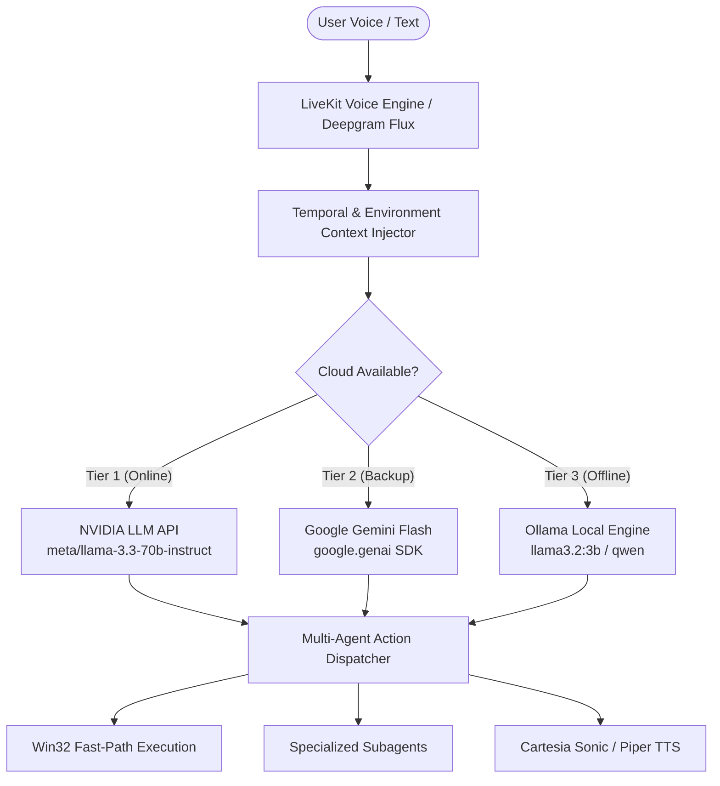
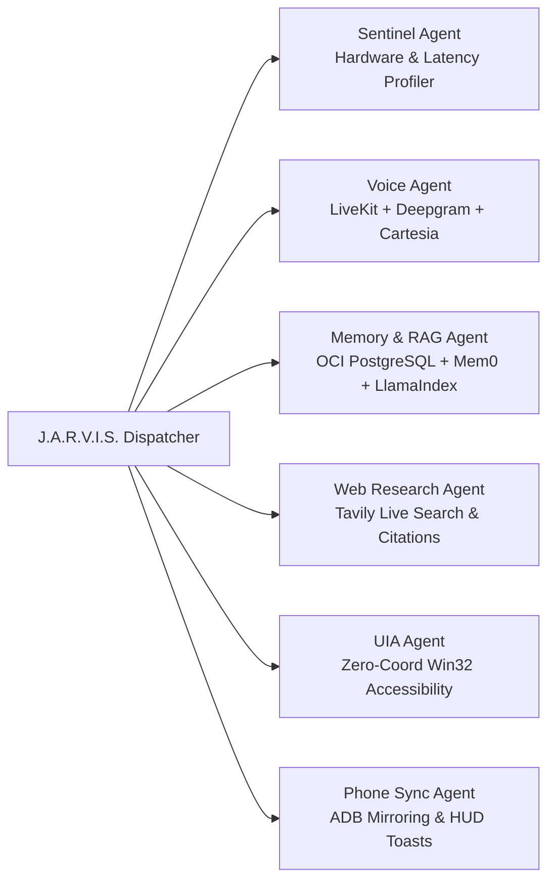

# J.A.R.V.I.S. Agent Architecture & Multi-Agent Roadmap

This document outlines the cognitive architecture of J.A.R.V.I.S., the rules governing its 3-tier brain (NVIDIA Llama 3.3 70B Primary + Gemini Flash Cloud Backup + Ollama Local Fallback), and the multi-agent orchestration roadmap.

---

## ⚡ 1. Finalized Component Matrix

| Component | Primary (Online) | Fallback (Offline / Failover) | Technical Role |
| :--- | :--- | :--- | :--- |
| **Real-Time Engine** | **LiveKit Agents** | Local Audio Loop | Manages WebRTC audio streams, VAD, and bidirectional interruption handling. |
| **Speech-to-Text (STT)** | **Deepgram Flux** | **Faster-Whisper** (Local) | Real-time streaming transcription with conversational boundary awareness. |
| **Turn Detection** | **Deepgram Flux Endpointing** *(Single Authority)* | Local VAD | Single master turn detector to avoid conflicting signals or false cutoffs. |
| **Text-to-Speech (TTS)** | **Cartesia Sonic** | **Piper TTS** (Local ONNX) | Primary: ~90ms natural conversational audio. Fallback: lightweight local synthesis. |
| **Core LLM** | **NVIDIA LLM API** (`llama-3.3-70b-instruct`) | **Ollama** (`llama3.2:3b` / `8b`) | Primary: high-speed 70B reasoning & debate. Fallback: local task execution. |
| **Database & Vectors** | **PostgreSQL + pgvector** *(OCI Hyderabad)* | Local Offline Buffer + Sync Queue | Enterprise hybrid search (Full-Text + Vector), relational memory, and citations. |
| **Long-Term Memory** | **Mem0** *(PostgreSQL Backend)* | Local JSONL Write-Ahead Log | Extracts facts, preferences, and user profile data across sessions with sync. |
| **RAG & Citations** | **LlamaIndex** *(Hybrid Engine)* | Local Document Cache | Vector similarity + SQL full-text search with strict page/document citations. |
| **Live Web Research** | **Tavily Search API** | DuckDuckGo | Real-time news and factual validation with cited URLs. |
| **Telemetry & Metrics** | **Custom Pipeline Profiler** | Built-in | Tracks live Time-To-First-Audio (TTFA) across STT, LLM, and TTS. |

---

## 🧠 2. Cognitive 3-Tier Brain Hierarchy

J.A.R.V.I.S. utilizes a **3-Tier Cognitive Architecture** to ensure zero latency, deep reasoning, and 100% offline uptime:

### 1. Tier 1 (Primary Online): NVIDIA NIM API (`meta/llama-3.3-70b-instruct`)
* **Endpoint:** `https://integrate.api.nvidia.com/v1`
* **Role:** High-speed 70-billion-parameter reasoning, Socratic debate logic, live tool calling, and document synthesis.
* **Debate Mode:** Deeply intellectual, challenges logical fallacies, and defends counter-arguments without generic disclaimers.

### 2. Tier 2 (Cloud Backup): Google Gemini Flash
* **SDK:** Modern official `google.genai` SDK.
* **Role:** High-speed cloud failover (~150-250ms TTFT) if NVIDIA hits rate limits or latency spikes.

### 3. Tier 3 (Offline Fallback): Ollama (`llama3.2:3b` / `8b`)
* **Endpoint:** `http://127.0.0.1:11434`.
* **Role:** Instant local failover if internet connectivity is completely lost. 100% offline guarantee.

---

## 🤖 3. Multi-Agent Orchestration Roster

### Agent 1: LiveKit Voice Agent Worker
* **Location:** [`voice/livekit_worker.py`](file:///C:/Users/Chowdary/Desktop/Project/Jarvis/voice/livekit_worker.py)
* **Responsibility:** Real-time WebRTC audio pipeline, streaming STT, and streaming TTS.
* **Unified Turn Authority:** Uses **Deepgram Flux** conversational endpointing as the single master turn detector to prevent VAD conflicts.
* **Instant Barge-In:** Cancels audio playback the millisecond user speech is detected.

### Agent 2: Speculative Preemptive Generation Agent
* **Responsibility:** Begins speculative draft generation during conversational pauses before the user's turn is 100% closed.
* **Conflict Resolution:** If the user resumes speaking, the speculative draft is discarded with zero disruption to the dialogue.

### Agent 3: Memory Persistence & RAG Agent
* **Locations:** [`memory/mem0_store.py`](file:///C:/Users/Chowdary/Desktop/Project/Jarvis/memory/mem0_store.py), [`memory/rag_engine.py`](file:///C:/Users/Chowdary/Desktop/Project/Jarvis/memory/rag_engine.py), [`memory/sync_queue.py`](file:///C:/Users/Chowdary/Desktop/Project/Jarvis/memory/sync_queue.py)
* **Responsibility:** Manages Mem0 user profile extraction, LlamaIndex hybrid RAG citations, and OCI PostgreSQL synchronization with local write-ahead buffering.

### Agent 4: Web Research Agent
* **Location:** [`tools/web_search.py`](file:///C:/Users/Chowdary/Desktop/Project/Jarvis/tools/web_search.py)
* **Responsibility:** Executes real-time web searches via Tavily, returning verified facts and source URLs.

### Agent 5: UIA & Desktop Automation Agent
* **Responsibility:** Inspects foreground windows via Win32 `EnumChildWindows`, computing bounding rectangles to target controls by name without pixel coordinates.

### Agent 6: Sentinel Hardware & Telemetry Agent
* **Responsibility:** Polls CPU, RAM, GPU, and network I/O, as well as tracking live Time-to-First-Audio (TTFA) telemetry.
