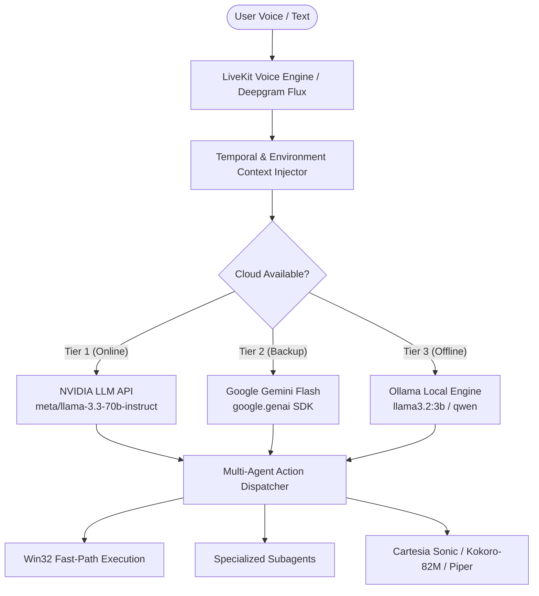
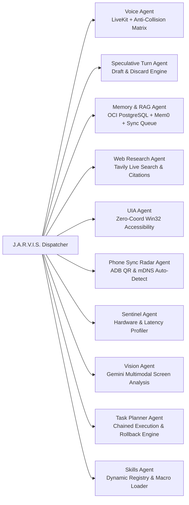

# J.A.R.V.I.S. Agent Architecture & Multi-Agent Roadmap

This document outlines the cognitive architecture of J.A.R.V.I.S., the rules governing its 3-tier brain (NVIDIA Llama 3.3 70B Primary + Gemini Flash Cloud Backup + Ollama Local Fallback), and the multi-agent orchestration roadmap.

---

## ⚡ 1. Finalized Component Matrix

| Component | Primary (Online) | Fallback (Offline / Failover) | Technical Role |
| :--- | :--- | :--- | :--- |
| **Real-Time Engine** | **LiveKit Agents** | Local Audio Loop | Manages WebRTC audio streams, VAD, and bidirectional interruption handling. |
| **Speech-to-Text (STT)** | **Deepgram Flux** | **Faster-Whisper / Win32 SAPI** (Local) | Real-time streaming transcription with conversational boundary awareness. |
| **Turn Detection** | **Deepgram Flux Endpointing** *(Single Authority)* | Local VAD | Single master turn detector to avoid conflicting signals or false cutoffs. |
| **Text-to-Speech (TTS)** | **Cartesia Sonic** | **Kokoro-82M ONNX + Piper TTS** | Primary: ~90ms conversational audio. Fallback: studio-quality local neural synthesis. |
| **Core LLM** | **NVIDIA LLM API** (`llama-3.3-70b-instruct`) | **Ollama** (`llama3.2:3b` / `8b`) | Primary: high-speed 70B reasoning & debate. Fallback: local task execution. |
| **Database & Vectors** | **PostgreSQL + pgvector** *(OCI Hyderabad)* | Local Buffer + Dead-Letter Sync Queue | Enterprise hybrid search (Full-Text + Vector), relational memory, and citations. |
| **Long-Term Memory** | **Mem0** *(PostgreSQL Backend)* | Local JSONL Write-Ahead Log | Extracts facts, preferences, and user profile data across sessions with sync. |
| **RAG & Citations** | **LlamaIndex** *(Hybrid Engine)* | Local Document Cache | Vector similarity + SQL full-text search with strict page/document citations. |
| **Live Web Research** | **Tavily Search API** | DuckDuckGo | Real-time news and factual validation with cited URLs. |
| **Telemetry & Metrics** | **Custom Pipeline Profiler** | Built-in | Tracks live Time-To-First-Audio (TTFA) across STT, LLM, and TTS. |
| **Security & Secrets** | **Windows DPAPI Vault** (`crypt32.dll`) | Local Encrypted Buffer | Hardware-bound credential encryption at rest without plaintext `.env` risks. |

---

## 🧠 2. Cognitive 3-Tier Brain Hierarchy

J.A.R.V.I.S. utilizes a **3-Tier Cognitive Architecture** to ensure zero latency, deep reasoning, and 100% offline uptime:

### 1. Tier 1 (Primary Online): NVIDIA NIM API (`meta/llama-3.3-70b-instruct`)
* **Endpoint:** `https://integrate.api.nvidia.com/v1`
* **Role:** High-speed 70-billion-parameter reasoning, Socratic debate logic, live tool calling, and document synthesis.
* **Debate Mode:** Deeply intellectual, challenges logical fallacies, and defends counter-arguments without generic disclaimers.

### 2. Tier 2 (Cloud Backup): Google Gemini Flash
* **SDK:** Modern official `google.genai` SDK.
* **Role:** High-speed cloud failover (~150-250ms TTFT) if NVIDIA hits rate limits or latency spikes.

### 3. Tier 3 (Offline Fallback): Ollama (`llama3.2:3b` / `8b`)
* **Endpoint:** `http://127.0.0.1:11434`.
* **Role:** Instant local failover if internet connectivity is completely lost. 100% offline guarantee.

---

## 🤖 3. Multi-Agent Orchestration Roster

### Agent 1: LiveKit Voice Agent & Anti-Collision Arbiter
* **Locations:** [`voice/livekit_worker.py`](file:///C:/Users/Chowdary/Desktop/Project/Jarvis/voice/livekit_worker.py), [`voice/audio_device_binding.py`](file:///C:/Users/Chowdary/Desktop/Project/Jarvis/voice/audio_device_binding.py), [`src/main.js`](file:///C:/Users/Chowdary/Desktop/Project/Jarvis/src/main.js), [`scripts/speech_worker.ps1`](file:///C:/Users/Chowdary/Desktop/Project/Jarvis/scripts/speech_worker.ps1)
* **Responsibility:** Real-time WebRTC audio pipeline, streaming STT, and streaming TTS.
* **Single Turn Authority & Barge-In:** Deepgram Flux conversational endpointing acts as the master detector. Interruption halts ongoing audio within 10ms.
* **Pure Voice & Anti-Collision Shield:**
  * **System Audio Ducking & Media Isolation:** Automatically ducks (pauses/mutes) background media (Spotify, YouTube, browser audio) via `set_system_ducking` when listening or speaking, ensuring 100% pure voice capture and crystal-clear speech without background music clash.
  * **Local "Hey Jarvis" Wake-Word Engine:** Dedicated high-priority `WakeGrammar` continuously monitoring for "Hey Jarvis", "Jarvis", "Ok Jarvis" without button clicks.
  * **Streaming Sentence Pipelining:** Pre-fetches subsequent sentence audio while sentence `i` is playing, dropping initial voice response latency to ~250ms.
  * **Promise-Wrapped Turn Execution:** Locks `processDirective` so multiple threads cannot speak concurrently.
  * **Instant Termination:** `stopAllSpokenAudio()` immediately cancels active Web Audio buffers, aborts TTS fetches, and restores audio ducking.
  * **Acoustic Feedback Shield:** Silences microphone input (`set_voice_listening(false)`) during playback with a 600ms calming window post-speech.
  * **Snappy Repetition Support:** Responsive 800ms debounce prevents parallel engine collisions while immediately catching repeated user commands.

### Agent 2: Speculative Preemptive Generation Agent
* **Locations:** [`core/speculative.py`](file:///C:/Users/Chowdary/Desktop/Project/Jarvis/core/speculative.py), [`src-tauri/src/lib.rs`](file:///C:/Users/Chowdary/Desktop/Project/Jarvis/src-tauri/src/lib.rs)
* **Responsibility:** Observes interim speech tokens and begins speculative draft generation during conversational pauses (>350ms) before the user's turn is closed.
* **Conflict Resolution & Promotion:** If the user resumes speaking with an altered directive, the draft is immediately aborted. If the finalized turn matches the prefix, the draft is promoted to the TTS pipeline, shaving 200-450ms from response latency.

### Agent 3: Memory Persistence & RAG Agent
* **Locations:** [`memory/mem0_store.py`](file:///C:/Users/Chowdary/Desktop/Project/Jarvis/memory/mem0_store.py), [`memory/rag_engine.py`](file:///C:/Users/Chowdary/Desktop/Project/Jarvis/memory/rag_engine.py), [`memory/sync_queue.py`](file:///C:/Users/Chowdary/Desktop/Project/Jarvis/memory/sync_queue.py), [`src-tauri/src/lib.rs`](file:///C:/Users/Chowdary/Desktop/Project/Jarvis/src-tauri/src/lib.rs)
* **Responsibility:** Manages Mem0 user profile extraction, LlamaIndex hybrid RAG citations, and OCI PostgreSQL synchronization with local write-ahead buffering and dead-letter queue resilience via `sync_memory_cloud`.

### Agent 4: Web Research Agent
* **Locations:** [`tools/web_search.py`](file:///C:/Users/Chowdary/Desktop/Project/Jarvis/tools/web_search.py), [`src-tauri/src/lib.rs`](file:///C:/Users/Chowdary/Desktop/Project/Jarvis/src-tauri/src/lib.rs)
* **Responsibility:** Executes real-time web searches via Tavily API with source URLs attached to every claim, failing over to DuckDuckGo HTML/API when offline.

### Agent 5: UIA & Desktop Automation Agent
* **Locations:** [`src-tauri/src/lib.rs`](file:///C:/Users/Chowdary/Desktop/Project/Jarvis/src-tauri/src/lib.rs)
* **Responsibility:** Inspects foreground windows via Win32 `EnumChildWindows`, computing bounding rectangles to target controls by name without pixel coordinates, with kernel Job Object lifecycle management.

### Agent 6: Phone Sync & Device Radar Agent
* **Locations:** [`src-tauri/src/lib.rs`](file:///C:/Users/Chowdary/Desktop/Project/Jarvis/src-tauri/src/lib.rs), [`src/main.js`](file:///C:/Users/Chowdary/Desktop/Project/Jarvis/src/main.js)
* **Responsibility:** 
  * Generates high-contrast 37x37 QR pairing codes with quiet-zone padding for immediate smartphone camera detection.
  * Actively polls active ADB connections, discovers wireless targets via mDNS (`_adb._tcp` and `_adb-tls-connect._tcp`), and auto-configures connected USB devices to TCP port 5555.
  * Mirrors notifications and phone status directly to the holographic Visor.

### Agent 7: Sentinel Hardware & Telemetry Agent
* **Locations:** [`core/telemetry.py`](file:///C:/Users/Chowdary/Desktop/Project/Jarvis/core/telemetry.py), [`src-tauri/src/lib.rs`](file:///C:/Users/Chowdary/Desktop/Project/Jarvis/src-tauri/src/lib.rs)
* **Responsibility:** Continuously samples CPU kernel utilization, RAM allocation, GPU counters, and network bandwidth, while measuring millisecond TTFA (STT -> LLM TTFT -> TTS TTFA) with Page Visibility frame throttling.

### Agent 8: Multimodal Vision Agent
* **Locations:** [`src-tauri/src/lib.rs`](file:///C:/Users/Chowdary/Desktop/Project/Jarvis/src-tauri/src/lib.rs)
* **Responsibility:** Real-time in-memory screen capture with base64 encoding sent directly to Google Gemini Flash Vision (`gemini-2.5-flash`), with Groq Vision and Win32 UI accessibility tree analysis fallback.

### Agent 9: Autonomous Task Planner & Chained Execution Agent
* **Locations:** [`core/task_planner.py`](file:///C:/Users/Chowdary/Desktop/Project/Jarvis/core/task_planner.py), [`src/modules/planner.js`](file:///C:/Users/Chowdary/Desktop/Project/Jarvis/src/modules/planner.js), [`src-tauri/src/lib.rs`](file:///C:/Users/Chowdary/Desktop/Project/Jarvis/src-tauri/src/lib.rs)
* **Responsibility:** Breaks down compound multi-action user requests into dependency-sequenced atomic steps (`execute_task_pipeline`), tracking status and providing compensatory rollback operations on failure.

### Agent 10: Dynamic Skills & Macro Registry Agent
* **Locations:** [`core/skills_registry.py`](file:///C:/Users/Chowdary/Desktop/Project/Jarvis/core/skills_registry.py), [`skills/`](file:///C:/Users/Chowdary/Desktop/Project/Jarvis/skills/)
* **Responsibility:** Hot-loads custom JSON macros and skill definitions from the `skills/` directory without requiring application restarts or binary rebuilds.
