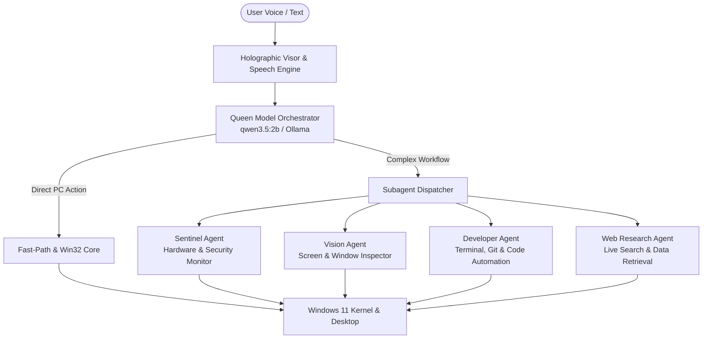

# J.A.R.V.I.S. Agent Architecture & Multi-Agent Roadmap

This document outlines the cognitive architecture of J.A.R.V.I.S., the rules governing its local neural brain (the **Queen Model**), and the roadmap for multi-agent delegation.

---

## 🧠 The Queen Model (Primary Orchestrator)

The core brain of J.A.R.V.I.S. is the **Queen Model**, hosted locally on Ollama at `http://127.0.0.1:11434`.

### 1. Role Definition
- **Identity**: Stark Industries AI Desktop Controller for Windows.
- **Authority**: Full administrator privileges on the local workstation.
- **Objective**: Rapidly parse user directives (voice or text), formulate execution plans, trigger the appropriate system action, and provide a concise, spoken status reply.

### 2. Behavioral Constraints & Guardrails
- **Strict Single-Dispatch**: The model MUST execute ONLY the single specific task requested. It never chains unrelated tasks or opens multiple instances of the same tool.
- **Pure JSON Output**:
  ```json
  {
    "action": "open_app" | "close_app" | "run_cmd" | "system_ctrl" | "none",
    "target": "<app, executable, or shell command>",
    "reply": "<spoken response under 12 words>"
  }
  ```
- **Zero Markdown Clutter**: No markdown blocks (````json ... ````), conversational preamble, or thought traces outside the raw JSON object.
- **Deterministic Inference**: Set with `temperature: 0.0` and `num_predict: 45` to minimize generation latency while guaranteeing reliable JSON parsing.

---

## 🤖 Multi-Agent Expansion Roadmap

As J.A.R.V.I.S. evolves into an autonomous operating companion, the architecture is designed to support specialized subagents operating under the Queen Model's coordination:



### Subagent Implementation Status

1. **Vision Agent (Holographic Screen Inspection)** - **ACTIVE**:
   - *Role*: Live Win32 desktop and foreground window inspection, active code/UI diagnostics.
   - *Model*: `qwen/qwen3.8-27b` on Groq LPU.
   - *Trigger*: *"Jarvis, inspect my screen"*, *"what is on my screen"*, or dock icon `👁️`.

2. **Web Research Agent (Online Ingestion & Synthesis)** - **ACTIVE**:
   - *Role*: Queries real-time Google News RSS & Wikipedia APIs, aggregates live data, and speaks concise syntheses without browser clutter.
   - *Model*: `qwen/qwen3.8-27b` on Groq LPU.
   - *Trigger*: *"search [topic]"*, *"who is [name]"*, *"latest news on [topic]"*, or dock icon `🌐`.

3. **Sentinel Agent (System Telemetry & Security)** - **ACTIVE**:
   - *Role*: Continuous background monitoring of hardware health (CPU, 64GB RAM, Network I/O, WinMM mic).

4. **Developer Agent (Code & Tool Automation)** - *Planned*:
   - *Role*: Manages git workflows, test suites, and PR automation directly from voice instructions.

---

## ⚙️ Model Selection Guidelines

Different tasks and hardware configurations benefit from targeted model selection:

| Model | Size | Quant | Inference Speed (CPU) | Best Used For |
| :--- | :--- | :--- | :--- | :--- |
| **`qwen3.5:2b`** *(Current)* | 1.9B | Q8_0 | ~14 tokens/s (2.5s) | Default balance: High accuracy instruction parsing with low memory footprint. |
| **`qwen2.5:1.5b`** | 1.5B | Q4_K_M | ~22 tokens/s (1.1s) | **Ultra-Low Latency Mode**: Recommended for near-instant voice dialogues on CPU. |
| **`qwen2.5:0.5b`** | 0.5B | Q4_K_M | ~40 tokens/s (0.4s) | **Lightning Mode**: Instant PC control on low-resource machines. |
| **`qwen2.5:7b`** | 7.6B | Q4_K_M | ~4 tokens/s (GPU req.) | Deep reasoning, script generation, and multi-step complex automation (requires NVIDIA GPU). |

### Switching the Active Model
To switch models in Ollama, simply pull the target model:
```powershell
ollama pull qwen2.5:1.5b
```
The Rust backend automatically queries `/api/ps` dynamically and binds the loaded model to the neural network matrix without code modifications.
